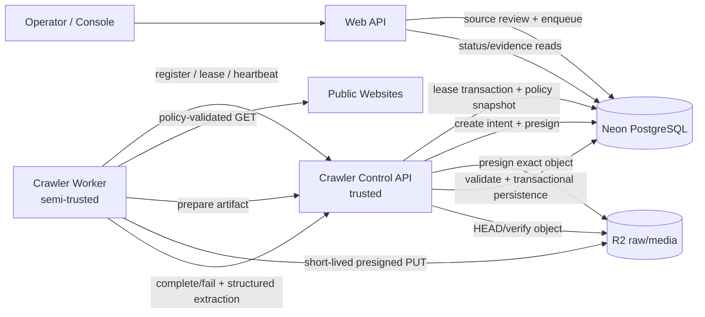

# Pending Task: Crawler Control Plane Migration

## Task metadata

| Field | Value |
| --- | --- |
| Status | **PENDING — not started** |
| Priority | Security / production hardening |
| Created | 2026-10-02 |
| Scope | Remove direct Neon and long-lived R2 credentials from the untrusted crawler worker runtime |
| Current design | Worker directly leases jobs from Neon, writes extraction results to Neon, and writes artifacts with R2 credentials |
| Target design | Worker communicates with a trusted Crawler Control API and uploads artifacts with short-lived presigned URLs |
| Execution rule | Do not perform this migration merely because this file exists. Start only after an explicit request to implement it. |

## 1. Objective

Migrate the crawler from this trust model:

```text
Crawler Worker
  ├── DATABASE_URL_UNPOOLED
  ├── R2_ACCESS_KEY_ID / R2_SECRET_ACCESS_KEY
  ├── direct job leasing and result writes
  └── fetches untrusted public websites
```

to this model:

```text
Crawler Worker
  ├── CRAWLER_CONTROL_URL
  ├── narrowly scoped, rotatable worker identity/token
  ├── short-lived per-object upload/download URLs
  └── no Neon or long-lived R2 credentials

Crawler Control API
  ├── trusted runtime
  ├── DATABASE_URL_UNPOOLED
  ├── scoped R2 credentials
  ├── owns leases, policy decisions, transactions and retries
  └── is the only component that mutates crawler/canonical database state
```

This migration is primarily a security-boundary change. It must preserve the existing crawler behavior, evidence model, job durability, replayability, source-review rules and page/byte/runtime budgets.

## 2. Why this task exists

The crawler fetches untrusted internet content and runs browser/parser dependencies. In the current implementation, the same runtime also holds credentials that can directly modify Neon and R2. A browser/runtime/dependency compromise could therefore have a larger blast radius than necessary.

A PostgreSQL connection proxy or pooler alone does **not** solve this problem because the worker would still need a database credential. The target is an application-level control plane with a narrow authenticated protocol.

The worker will still hold a credential, but that credential must only authorize crawler operations such as leasing one job, extending its lease, preparing a specific object upload, and completing or failing that leased job. It must not allow arbitrary SQL, bucket listing, deletion, or access to unrelated application data.

## 3. Non-goals

Do not include these changes unless separately requested:

- Replacing Scrapling or the connector interface.
- Changing source legal/policy review requirements.
- Allowing CAPTCHA solving or authentication bypass.
- Publishing crawler assertions directly as canonical truth.
- Replacing Neon as the durable job/run source of truth.
- Replacing R2 as the production artifact store.
- Adding public crawler-management APIs.
- Sending raw HTML, PDF, or image bytes through the Control API.
- Removing local filesystem artifact mode from developer workflows.

## 4. Current implementation to preserve

Before implementation, re-read these files and treat the code—not this document—as the final source of truth for current behavior:

| Area | Current files |
| --- | --- |
| Worker CLI and loop | `workers/crawler/src/kita_crawler/cli.py` |
| Worker orchestration | `workers/crawler/src/kita_crawler/service.py` |
| DB leasing and persistence | `workers/crawler/src/kita_crawler/repository.py` |
| Strict contracts | `workers/crawler/src/kita_crawler/models.py` |
| Fetch safety | `workers/crawler/src/kita_crawler/safety.py` |
| Object storage | `workers/crawler/src/kita_crawler/storage.py` |
| Website connector | `workers/crawler/src/kita_crawler/connectors/website.py` |
| AnimeCons connector | `workers/crawler/src/kita_crawler/connectors/animecons.py` |
| Web source/run API | `app/api/crawler/` and `db/crawler.ts` |
| Evidence reads | `db/crawlerEvidence.ts` |
| Schema migrations | `infra/sql/0001_*.sql` through `0004_*.sql` |
| Crawler container | `docker/crawler.Dockerfile` |
| Render deployment | `render.yaml` |
| Accepted current ADR | `docs/adr/0001-crawler-runtime.md` |

Behavior that must remain true:

- Sources are denied until enabled and `REVIEWED_ALLOWED`.
- Fetches are GET-only and checked against domain/path/network policy.
- HTTP is default; browser/stealth modes remain policy-gated.
- Jobs are durable and support multiple workers.
- Lease expiration permits recovery after worker loss.
- Raw evidence is retained and replayable.
- URL/content hashes avoid unnecessary RawDocument versions.
- Media is hashed/deduplicated and does not override pinned defaults.
- Discovery creates bounded child URL/media jobs.
- AnimeCons official-site auto-approval happens only when the reviewed parent policy explicitly permits it.
- Retry delay and terminal failure semantics are preserved.
- Object-write reconciliation remains possible.

## 5. Target architecture



### Trust boundaries

| Component | Trust level | May hold DB credential | May hold long-lived R2 credential |
| --- | --- | --- | --- |
| Web/API | Trusted | Yes, scoped | Only if needed for signed downloads |
| Crawler Control API | Trusted | Yes, scoped | Yes, bucket-scoped |
| Crawler Worker | Semi-trusted | **No** | **No** |
| Browser subprocess | Untrusted workload | No | No |

## 6. Target runtime layout

Implement the first version in the existing Python crawler package to minimize behavioral rewrites:

```text
workers/crawler/src/kita_crawler/
  control_api.py          # trusted FastAPI application
  control_auth.py         # worker authentication and lease-token validation
  control_client.py       # worker-side HTTP client
  contracts.py            # versioned API request/response models
  repository.py           # stays server-side; never instantiated in API-mode worker
  service.py              # fetch/extract separated from DB persistence
```

Add a separate deployment image:

```text
docker/crawler-control.Dockerfile
```

The worker and Control API may share source/models, but they must run as distinct services with distinct environment variables. Security comes from runtime credentials and authorization boundaries; the presence of repository code in the installed package is not itself authority to access Neon.

Recommended server/runtime additions:

- `fastapi`
- `uvicorn`
- an async or sync HTTP client for the worker, such as `httpx`
- existing Psycopg and Boto3 remain Control API dependencies

If implementation discovers a clean package split is required, create shared contract and execution packages, but do not duplicate Pydantic models between the worker and Control API.

## 7. Versioned internal API contract

Use a versioned, internal-only prefix:

```text
/internal/v1/crawler
```

The API must use HTTPS outside localhost. It must not rely solely on obscurity or an unguessable URL.

### 7.1 Authentication

Preferred production authentication order:

1. Workload identity/OIDC with short-lived tokens and audience binding.
2. If unavailable initially, a rotatable service token from the deployment secret manager.

Initial environment variables may be:

```dotenv
# Worker only
CRAWLER_QUEUE_MODE=control_api
CRAWLER_CONTROL_URL=https://crawler-control.internal.example
CRAWLER_CONTROL_TOKEN=replace-with-scoped-secret

# Control API only
DATABASE_URL_UNPOOLED=postgresql://...
R2_ENDPOINT_URL=https://...
R2_ACCESS_KEY_ID=...
R2_SECRET_ACCESS_KEY=...
R2_RAW_BUCKET=kitacon-raw
R2_MEDIA_BUCKET=kitacon-media
CRAWLER_CONTROL_TOKEN_HASH=...
```

Requirements:

- Never store a plaintext worker token in Neon.
- Never log Authorization headers, lease tokens, presigned URLs or R2 credentials.
- Bind tokens to a worker/service identity and expected audience.
- Support rotation without rebuilding an image.
- Rate-limit authentication failures.

### 7.2 Register worker

```http
POST /internal/v1/crawler/workers/register
Authorization: Bearer <worker-credential>
Content-Type: application/json
```

Request:

```json
{
  "workerName": "kitacon-render-crawler",
  "workerVersion": "0.2.0",
  "capabilities": [
    "SCRAPLING_HTTP",
    "SCRAPLING_BROWSER",
    "HTML_PARSE",
    "PDF_TEXT_EXTRACT",
    "PRESIGNED_OBJECT_UPLOAD"
  ]
}
```

Response `200`:

```json
{
  "workerId": "uuid",
  "heartbeatIntervalSeconds": 5,
  "serverTime": "ISO-8601"
}
```

Registration must be idempotent by authenticated identity + `workerName`.

### 7.3 Lease a job

```http
POST /internal/v1/crawler/jobs/lease
```

Request:

```json
{
  "workerId": "uuid",
  "capabilities": ["SCRAPLING_HTTP", "SCRAPLING_BROWSER"],
  "maxJobs": 1
}
```

No work: `204 No Content`.

Work available: `200 OK`

```json
{
  "contractVersion": "1.0",
  "job": {
    "id": "job-uuid",
    "type": "URL_FETCH",
    "attempt": 1,
    "maxAttempts": 4,
    "leaseExpiresAt": "ISO-8601",
    "leaseToken": "opaque-single-lease-token",
    "payload": {
      "request_id": "uuid",
      "source_id": "source-uuid",
      "url": "https://example.com/event",
      "canonical_url": "https://example.com/event",
      "page_type": "EVENT",
      "depth": 0,
      "method": "GET",
      "dedupe_key": "stable-key",
      "expected_content_types": ["text/html"],
      "fetch_mode_hint": "AUTO",
      "priority": "NORMAL",
      "metadata": {}
    }
  },
  "run": {
    "id": "run-uuid",
    "rootEventId": "event-uuid or null",
    "remainingBytes": 262144000,
    "remainingPages": 99,
    "remainingRuntimeSeconds": 1800
  },
  "sourcePolicy": {
    "sourceId": "source-uuid",
    "connectorKey": "website",
    "connectorVersion": "1.0.0",
    "enabled": true,
    "termsReviewStatus": "REVIEWED_ALLOWED",
    "allowedDomains": ["example.com"],
    "allowedPathPrefixes": ["/"],
    "deniedPathPrefixes": [],
    "maxDepth": 3,
    "maxPagesPerRun": 100,
    "maxBytesPerRun": 262144000,
    "maxRuntimeSeconds": 1800,
    "defaultFetchMode": "HTTP",
    "allowStealth": false,
    "timezone": "UTC",
    "configuration": {}
  }
}
```

Rules:

- Control API, not the worker, determines lease eligibility.
- Continue to use a transaction and `FOR UPDATE SKIP LOCKED` internally.
- Generate a new cryptographically random lease token for every lease attempt.
- Store only its hash with the job.
- Bind lease token to job ID, attempt/generation, worker ID and expiry.
- Return the run's immutable policy snapshot, not an unreviewed worker-supplied policy.
- Return `409` if an old client attempts an incompatible contract version.

### 7.4 Extend lease / heartbeat

```http
POST /internal/v1/crawler/jobs/{jobId}/heartbeat
```

Request:

```json
{
  "workerId": "uuid",
  "leaseToken": "opaque-single-lease-token",
  "progress": {
    "stage": "FETCHING",
    "elapsedMs": 45000
  }
}
```

Response `200`:

```json
{
  "leaseExpiresAt": "ISO-8601",
  "cancelRequested": false
}
```

Requirements:

- Add active lease renewal; do not keep the current fixed 120-second no-renewal behavior.
- Reject stale token, wrong worker, wrong attempt and already-terminal jobs.
- Worker must stop result submission when lease renewal is rejected.
- Long browser fetches need a renewal mechanism that does not wait for fetch completion.

### 7.5 Prepare artifact upload

Do not pre-sign an upload at lease time because the final content hash, size, type and deterministic object key are not yet known.

```http
POST /internal/v1/crawler/jobs/{jobId}/artifacts/prepare
```

Request:

```json
{
  "workerId": "uuid",
  "leaseToken": "opaque-single-lease-token",
  "kind": "RAW_DOCUMENT",
  "contentSha256": "hex-sha256",
  "contentType": "text/html",
  "byteSize": 123456,
  "sourceUrl": "https://example.com/event"
}
```

Response `201`:

```json
{
  "artifactId": "object-write-intent-uuid",
  "bucket": "kita-raw",
  "objectKey": "deterministic/server-generated-key",
  "upload": {
    "method": "PUT",
    "url": "short-lived-presigned-url",
    "requiredHeaders": {
      "Content-Type": "text/html",
      "x-amz-meta-content-sha256": "hex-sha256"
    },
    "expiresAt": "ISO-8601"
  }
}
```

Rules:

- Server computes bucket and object key; never accept an arbitrary bucket/key from worker.
- Validate byte size against job/run budget before signing.
- Create/update `object_write_intent` as `PENDING` before returning the URL.
- Presign only PUT for the exact key with a short lifetime, preferably 5 minutes or less.
- Worker cannot list or delete objects.
- Completion must verify the object exists and matches expected size/type/hash metadata.
- Captured XHR and media artifacts use separate prepare calls and appropriate kind/bucket.

### 7.6 Complete job

```http
POST /internal/v1/crawler/jobs/{jobId}/complete
```

Request outline:

```json
{
  "contractVersion": "1.0",
  "completionId": "client-generated-uuid",
  "workerId": "uuid",
  "leaseToken": "opaque-single-lease-token",
  "fetch": {
    "requestedUrl": "https://example.com/event",
    "finalUrl": "https://example.com/event",
    "statusCode": 200,
    "mode": "HTTP",
    "requestHeadersRedacted": {},
    "responseHeadersRedacted": {},
    "contentType": "text/html",
    "encoding": "utf-8",
    "contentLength": 123456,
    "fetchedAt": "ISO-8601",
    "durationMs": 820,
    "etag": null,
    "lastModified": null,
    "contentSha256": "hex-sha256",
    "blockedReason": null
  },
  "artifacts": [
    {
      "artifactId": "object-write-intent-uuid",
      "kind": "RAW_DOCUMENT",
      "contentSha256": "hex-sha256"
    }
  ],
  "extraction": {
    "connectorKey": "website",
    "connectorVersion": "1.0.0",
    "schemaVersion": "1.0.0",
    "sourceRecords": [],
    "assertions": [],
    "discoveredLinks": [],
    "documentChunks": [],
    "mediaCandidates": [],
    "warnings": [],
    "qualitySignals": {}
  }
}
```

Response `200`:

```json
{
  "jobId": "uuid",
  "status": "SUCCEEDED",
  "rawDocumentId": "uuid",
  "childJobsCreated": 4,
  "mediaJobsCreated": 2,
  "alreadyCompleted": false
}
```

Requirements:

- Treat `completionId` as an idempotency key.
- Replaying the exact completion returns the original receipt with `alreadyCompleted=true`.
- A different completion for the same job/attempt must return `409`.
- Validate the lease before accepting results.
- Re-run server-side URL/policy/budget validation; never trust worker classification alone.
- Verify prepared artifacts with object-store HEAD before committing DB references.
- Reconstruct and strictly validate `FetchResult`/`ExtractionBatch` contracts.
- Apply official-site auto-approval from the server-held policy snapshot, not a worker assertion.
- Persist fetch attempt, RawDocument, chunks, assertions, candidates, graph, media candidates, child jobs, source sync state and job/run status in a database transaction.
- Mark object intents `COMMITTED` only after successful persistence.
- Enforce a bounded request size. If real fixtures exceed that limit, implement an extraction-manifest upload through the same presigned artifact flow instead of raising the global API limit without analysis.

### 7.7 Complete unchanged result

The Control API should detect an existing `source_id + canonical_url + content_hash` and perform the current unchanged-document behavior. Worker may provide the hash but must not decide that no record is required.

Response still uses the completion endpoint:

```json
{
  "jobId": "uuid",
  "status": "SUCCEEDED",
  "rawDocumentId": "existing-uuid",
  "unchanged": true,
  "alreadyCompleted": false
}
```

### 7.8 Fail job

```http
POST /internal/v1/crawler/jobs/{jobId}/fail
```

Request:

```json
{
  "failureId": "client-generated-uuid",
  "workerId": "uuid",
  "leaseToken": "opaque-single-lease-token",
  "retryableHint": true,
  "error": {
    "code": "HTTP_503",
    "class": "FetchError",
    "message": "Upstream returned HTTP 503"
  },
  "metrics": {
    "durationMs": 30120,
    "bytesReceived": 0
  }
}
```

Response:

```json
{
  "jobId": "uuid",
  "status": "RETRY_WAIT",
  "nextAttemptAt": "ISO-8601 or null",
  "attemptCount": 1,
  "maxAttempts": 4
}
```

The Control API—not the worker—decides retry vs terminal failure and calculates backoff. Preserve the current permanent error rules unless intentionally changed in a separate reviewed decision.

### 7.9 Health endpoints

Expose separate endpoints:

```text
GET /health/live   # process is running; no dependency check
GET /health/ready  # DB and required object-store operations are usable
```

Do not expose credentials, connection strings, bucket listings or detailed internal errors.

## 8. Database migration

Create an additive migration, expected name:

```text
infra/sql/0005_crawler_control_plane.sql
```

Exact schema may evolve during implementation, but it must support:

- Hashed per-attempt lease tokens.
- Lease generation/revision to invalidate old tokens.
- Worker identity association.
- Idempotent completion/failure receipts.
- Contract/schema version audit.
- Prepared artifact ownership by job + attempt.
- Safe compatibility with existing jobs during rollout.

Suggested additions:

```sql
ALTER TABLE ingestion.job
  ADD COLUMN lease_generation integer NOT NULL DEFAULT 0,
  ADD COLUMN lease_token_hash text,
  ADD COLUMN result_contract_version text;

CREATE TABLE ingestion.job_completion_receipt (
  id uuid PRIMARY KEY DEFAULT gen_random_uuid(),
  job_id uuid NOT NULL REFERENCES ingestion.job(id) ON DELETE CASCADE,
  lease_generation integer NOT NULL,
  completion_id uuid NOT NULL,
  request_sha256 text NOT NULL,
  response_json jsonb NOT NULL,
  created_at timestamptz NOT NULL DEFAULT now(),
  UNIQUE(job_id, lease_generation),
  UNIQUE(completion_id)
);
```

Review whether `object_write_intent` needs these additive fields:

```text
lease_generation
artifact_kind
prepared_by_worker_id
upload_expires_at
verified_at
```

Do not store plaintext lease tokens or presigned URLs.

### Source policy snapshot correction

The current Python CLI enqueue path stores a full `SourcePolicy` snapshot, while the Web enqueue path currently stores only limited fields in `policy_snapshot`. Fix this inconsistency before API-mode leasing:

- Web enqueue must load and snapshot all security-relevant policy fields.
- Lease response must use the immutable run snapshot.
- During rollout, old incomplete snapshots may fall back to the current reviewed source only through an explicitly tested compatibility path.
- New runs must never rely on that fallback.

### Database roles

Provision a dedicated Control API role with least privilege. Do not use database owner credentials at runtime.

After rollout:

- Revoke crawler worker database access.
- Control API may access only required ingestion/event/media objects.
- Web/API retains only the rights needed for source management and evidence reads.
- Migrations run under a separate administrative role.

Avoid putting environment-specific passwords in migrations.

## 9. Refactor plan

### Phase 0 — Record decision and establish safety net

- [ ] Add `docs/adr/0002-crawler-control-plane.md` with status `Proposed` during implementation.
- [ ] Document that ADR 0002 supersedes the direct-worker DB portion of ADR 0001 only after rollout.
- [ ] Capture current integration fixtures and expected DB results.
- [ ] Add tests for current URL, unchanged content, discovery, media, retry and official-site workflows before refactoring.
- [ ] Confirm no unrelated dirty-worktree changes are overwritten.

### Phase 1 — Immediate least-privilege hardening

This phase is valuable even if later phases are postponed.

- [ ] Create a dedicated crawler DB role with no DDL/admin/public-data rights.
- [ ] Limit R2 credentials to `kita-raw` and `kita-media` only.
- [ ] Move secrets to the deployment secret manager; never bake them into images.
- [ ] Add secret-redaction tests for logs and exceptions.
- [ ] Document credential rotation.

### Phase 2 — Separate execution from persistence

Refactor without changing runtime mode yet:

- [ ] Split `CrawlerService.process_job()` into fetch/extract output and persistence operations.
- [ ] Introduce versioned Pydantic request/response contracts.
- [ ] Keep the direct database adapter behind an interface for temporary compatibility.
- [ ] Ensure extraction output is JSON serializable without raw body bytes.
- [ ] Ensure server-side persistence can reconstruct all current rows and child jobs.
- [ ] Preserve deterministic IDs/dedupe keys or explicitly migrate them.

Suggested interfaces:

```python
class JobSource(Protocol):
    async def register_worker(...): ...
    async def lease_job(...): ...
    async def heartbeat(...): ...
    async def prepare_artifact(...): ...
    async def complete_job(...): ...
    async def fail_job(...): ...

class DirectDatabaseJobSource(JobSource): ...
class ControlApiJobSource(JobSource): ...
```

The direct adapter exists only for migration/rollback and must be removable after stabilization.

### Phase 3 — Build the trusted Control API

- [ ] Add authenticated register, lease, heartbeat, artifact prepare, complete and fail endpoints.
- [ ] Move all job/run state transitions behind Control API transactions.
- [ ] Move source-policy loading and official-site approval decisions server-side.
- [ ] Add object-store HEAD verification and intent commit/reconciliation.
- [ ] Add liveness/readiness endpoints.
- [ ] Add structured audit logs with job/run/worker/trace IDs.
- [ ] Add `docker/crawler-control.Dockerfile`.
- [ ] Add a dedicated deployment definition and health checks.

### Phase 4 — Add worker API mode

- [ ] Add `CRAWLER_QUEUE_MODE=database|control_api`.
- [ ] Default existing installations to `database` during the compatibility release.
- [ ] Implement timeouts, bounded retries and jitter in `control_client.py`.
- [ ] Do not retry `complete` with a new completion ID after an uncertain response; reuse the same ID.
- [ ] Add background lease renewal for long fetches.
- [ ] Upload artifacts only with prepared presigned URLs.
- [ ] Remove DB and Boto3 object-store calls from the API-mode execution path.
- [ ] Update `doctor` to validate Control API auth, lease protocol and presigned upload round trip without requiring DB/R2 secrets.

### Phase 5 — Canary rollout

- [ ] Deploy the Control API first and leave direct workers unchanged.
- [ ] Verify readiness and production-safe authentication.
- [ ] Start one API-mode canary worker with a unique worker name.
- [ ] Run a bounded reviewed source with small page/byte limits.
- [ ] Compare DB records and R2 artifacts with current expected behavior.
- [ ] Test worker restart during fetch, after upload and during completion.
- [ ] Test expired lease and duplicate completion.
- [ ] Expand to normal sources only after the canary passes.

Do not run direct and API-mode workers against the same jobs unless lease generation/token enforcement is complete.

### Phase 6 — Remove credentials from crawler runtime

- [ ] Set all workers to `CRAWLER_QUEUE_MODE=control_api`.
- [ ] Remove `DATABASE_URL`, `DATABASE_URL_UNPOOLED`, `R2_ACCESS_KEY_ID` and `R2_SECRET_ACCESS_KEY` from worker deployment configuration.
- [ ] Confirm those variables are absent through deployment configuration and runtime inspection.
- [ ] Revoke the old crawler DB role and R2 token.
- [ ] Keep credentials only in trusted Control API/Web deployments.
- [ ] Change API-mode to the default and require explicit development opt-in for direct mode.

### Phase 7 — Cleanup and decision finalization

- [ ] Remove direct mode after an agreed stabilization period, or mark it local-development-only.
- [ ] Remove unused worker-side Psycopg/Boto3 dependencies if packaging permits.
- [ ] Update `docker/crawler.Dockerfile`, `render.yaml`, `.env.example`, root README, crawler README and runbook.
- [ ] Change ADR 0002 to `Accepted`.
- [ ] Mark the affected direct-access decision in ADR 0001 as superseded.
- [ ] Change this task status to `COMPLETED` with rollout date and evidence links.

## 10. Security requirements

- [ ] Worker has no Neon credential in API mode.
- [ ] Worker has no long-lived R2 credential in API mode.
- [ ] Every internal endpoint requires authenticated workload identity.
- [ ] Lease tokens are random, short-lived, per-attempt and stored hashed.
- [ ] Presigned URLs are exact-object, operation-specific and short-lived.
- [ ] Server chooses bucket/key and verifies artifact metadata.
- [ ] Worker cannot list/delete buckets or query arbitrary objects.
- [ ] Server revalidates policy, budget and schema before writes.
- [ ] URL query secrets and sensitive headers remain redacted.
- [ ] Request body limits exist for every endpoint.
- [ ] Extraction collection lengths and individual string sizes are bounded.
- [ ] Logs never contain auth tokens, lease tokens or full presigned URLs.
- [ ] TLS certificate validation is never disabled.
- [ ] Control API is private-network-only where available; authentication remains required even on a private network.
- [ ] Auth token rotation has a tested overlap procedure.

## 11. Reliability and idempotency requirements

- [ ] Delivery semantics are explicitly at-least-once, not exactly-once.
- [ ] Job completion is idempotent by `completionId` + request hash.
- [ ] Old lease generations cannot complete a re-leased job.
- [ ] Lease renewal prevents legitimate long jobs from being duplicated.
- [ ] Job loss/restart returns work to the queue after lease expiry.
- [ ] Upload-before-completion crashes leave a reconcilable intent.
- [ ] Completion-before-response-loss can be retried with the same ID.
- [ ] Child job/source/media creation remains deduplicated.
- [ ] Control API temporary outage does not discard a leased result; worker retries within lease or safely reports after recovery.
- [ ] Retry/backoff and `DEAD` semantics remain server-owned.

## 12. Observability requirements

Every request/log/metric should carry, when available:

```text
trace_id
worker_id
worker_name
job_id
crawl_run_id
source_id
attempt_count
lease_generation
contract_version
```

Add metrics for:

- Lease requests, no-work responses and lease latency.
- Active workers and heartbeat age.
- Lease extensions/rejections/expirations.
- Jobs completed/retried/dead by error code.
- Completion idempotency hits/conflicts.
- Artifact prepare/upload/verification failures.
- Control API DB and R2 latency.
- Payload size and validation rejection counts.
- Queue age and end-to-end crawl latency.

Alert on:

- No online worker while runnable jobs exist.
- Rising expired leases or duplicate completions.
- Control API readiness failure.
- Repeated auth failures.
- Old `PENDING` object-write intents.
- Sudden increase in blocked or failed fetches.

## 13. Test plan

### Unit tests

- [ ] Contract serialization and unknown-field rejection.
- [ ] Token hash/validation and generation mismatch.
- [ ] Policy snapshot mapping.
- [ ] Retry classification and backoff.
- [ ] Object-key generation and bucket selection.
- [ ] Completion request hashing/idempotency.
- [ ] Log redaction.

### Integration tests

- [ ] Two workers concurrently lease different jobs.
- [ ] A leased job cannot be leased again before expiry.
- [ ] Lease heartbeat extends expiry.
- [ ] Stale worker/token cannot complete a re-leased job.
- [ ] Duplicate completion returns the same receipt and creates no duplicate rows.
- [ ] Different duplicate completion returns `409`.
- [ ] Presigned upload creates a verifiable object and intent.
- [ ] Wrong size/hash/bucket/key is rejected.
- [ ] Completion transaction writes the same evidence graph as the current direct path.
- [ ] Failure produces `RETRY_WAIT` and later `DEAD` correctly.
- [ ] Official-site discovery cannot self-approve without snapshot permission.
- [ ] Page/byte/runtime limits remain enforced server-side.

### End-to-end tests

Use existing fixtures and at least one reviewed, bounded live source:

- [ ] Website seed -> child pages -> chunks/assertions/media.
- [ ] AnimeCons event -> canonical event/source candidate.
- [ ] Explicit official-site follow-on workflow.
- [ ] Unchanged content.
- [ ] PDF extraction.
- [ ] Captured XHR artifact.
- [ ] Media dedupe and pinned-cover protection.
- [ ] Worker terminated after artifact upload but before completion.
- [ ] Control API restarted during lease.
- [ ] Worker runtime inspected to confirm DB/R2 credentials are absent.

### Required validation commands

Adapt commands if scripts change, but retain equivalent coverage:

```bash
npm run lint
npx tsc --noEmit
npm test
workers/crawler/.venv/bin/pytest workers/crawler/tests
```

Add dedicated Control API and API-mode end-to-end test commands to `package.json` or the crawler project and document them.

## 14. Deployment changes

Target deployment has three relevant services connected to the same Neon branch:

```text
Web/API                 -> Neon, signed read downloads
Crawler Control API     -> Neon + R2, private authenticated worker API
Crawler Worker          -> Control API + public source websites only
```

Update `render.yaml` or the chosen deployment configuration to define distinct services and secret sets.

Worker allowlist/outbound needs:

- Control API hostname.
- Reviewed public source hostnames.
- R2 presigned URL hostname.

Worker must not need direct network access to the Neon endpoint after cutover.

## 15. Rollout gates

Do not advance from canary until all are true:

- [ ] No duplicate RawDocuments/assets/jobs caused by retries.
- [ ] Run counters and final statuses match expected behavior.
- [ ] Replay/evidence downloads still work.
- [ ] Lease recovery has been exercised, not just unit-tested.
- [ ] API-mode worker contains no DB/R2 secret.
- [ ] Control API authentication and rate limits have been reviewed.
- [ ] Artifact reconciliation has been tested.
- [ ] Operator status/evidence UI still works without schema regressions.

## 16. Rollback plan

Keep schema changes additive through the canary/stabilization period.

If rollout fails before credential revocation:

1. Stop API-mode workers so they release/no longer renew leases.
2. Wait for active leases to complete or expire.
3. Set trusted fallback worker to `CRAWLER_QUEUE_MODE=database`.
4. Restore its scoped DB/R2 secrets from the secret manager.
5. Start one direct worker and confirm heartbeat/job progress.
6. Keep the Control API deployed but stop sending it work while investigating.

If old credentials have already been revoked, create new temporary scoped credentials rather than re-enabling a previously exposed secret.

Do not roll back additive database columns/tables during an incident. Remove them only in a later reviewed cleanup migration after all clients are compatible.

## 17. Definition of done

This task is complete only when:

- [ ] Production crawler workers lease, heartbeat, upload and complete through Control API.
- [ ] Worker deployment has no Neon connection string.
- [ ] Worker deployment has no R2 access key or secret key.
- [ ] Control API owns all job state transitions and result transactions.
- [ ] Existing `/api/candidates` editorial review, materialize, link and reject behavior remains owned by the trusted Web/API runtime; the worker cannot call these endpoints to self-approve or publish canonical records.
- [ ] Source auto-creation/approval remains policy-controlled server-side.
- [ ] Presigned artifacts are exact-key and short-lived.
- [ ] Lease renewal and stale-generation rejection work in production-like tests.
- [ ] All required unit/integration/end-to-end tests pass.
- [ ] Canary evidence matches the legacy path.
- [ ] Old direct credentials are revoked.
- [ ] Runbooks, environment examples, deployment definitions and architecture docs are updated.
- [ ] ADR 0002 is accepted and ADR 0001 is marked partially superseded.
- [ ] This document records completion date, migration version and rollback window closure.

## 18. Completion record

Fill this section only after successful rollout:

```text
Status: COMPLETED
Completed at:
Implemented by:
Database migration:
Control API version:
Worker version:
Canary run IDs:
Credential revocation evidence:
Rollback window closed at:
Known follow-up tasks:
```
