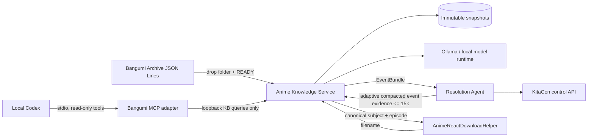

# Architecture

## System context



## Package boundary

```text
packages/anime-knowledge-service/
├── src/
│   ├── cli.ts
│   ├── config.ts
│   ├── server.ts
│   ├── mcp.ts
│   ├── identity/bangumi.ts
│   ├── kb/
│   │   ├── manager.ts
│   │   └── store.ts
│   ├── llm/client.ts
│   └── pipelines/
│       ├── event.ts
│       └── filename.ts
├── test/
├── docs/
├── Dockerfile
└── docker-compose.yml
```

## Import sequence

```mermaid
sequenceDiagram
  participant U as Operator/Finder
  participant I as imports/<version>
  participant K as Knowledge Service
  participant S as snapshots

  U->>I: Copy JSON Lines
  U->>I: Add READY after copy completes
  K->>I: Detect ready version
  K->>S: Build private staging snapshot
  K->>K: Validate and load smoke test
  alt valid
    K->>S: Rename staging to immutable version
    K->>K: Atomically replace active.json
  else invalid
    K->>K: Record FAILED; retain current snapshot
  end
```

## Trust boundaries

- JSON Lines are untrusted and validated record by record.
- LLM responses are untrusted and validated with shared Zod contracts.
- The LLM sees only bounded candidates; canonical objects are reconstructed by the service.
- Event resolution uses one model call. Entity queries come from deterministic typed-field extraction; Bangumi candidates are admitted by score only while the final prompt stays at or below 24k estimated tokens.
- The model returns a JSON-Schema-constrained semantic enrichment patch. The service applies it to the complete deterministic bundle, so the model never has to repeat schedules, exhibitors, links, media, or evidence it did not change.
- Consumers never receive arbitrary file access.
- The service has no database or object-storage credentials.
- The local Codex MCP adapter exposes only bounded KB search and exact lookup; it has no model, crawler, or publication tools.
- Ollama stays a separate process so model loading, Metal acceleration, and memory lifecycle remain replaceable.

## Why this is not part of Resolution Agent

Resolution Agent is a KitaCon-specific leased-job worker. The knowledge/model layer has multiple consumers and its own update lifecycle. Separating them prevents Bangumi and prompt logic from being duplicated while keeping KitaCon job authority out of a service that processes untrusted model input.

Resolution Agent owns crawler-aware deduplication because it understands page types, assertion confidence, and media signals. Anime Knowledge Service owns the final guard because only it knows the size of its instructions, baseline, and retrieved Bangumi graph.
