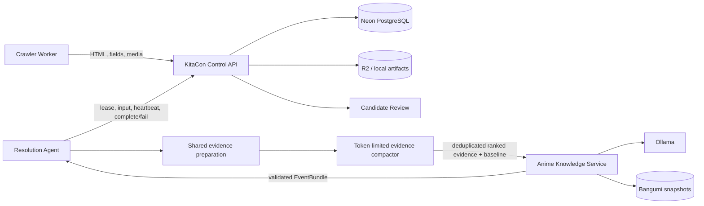
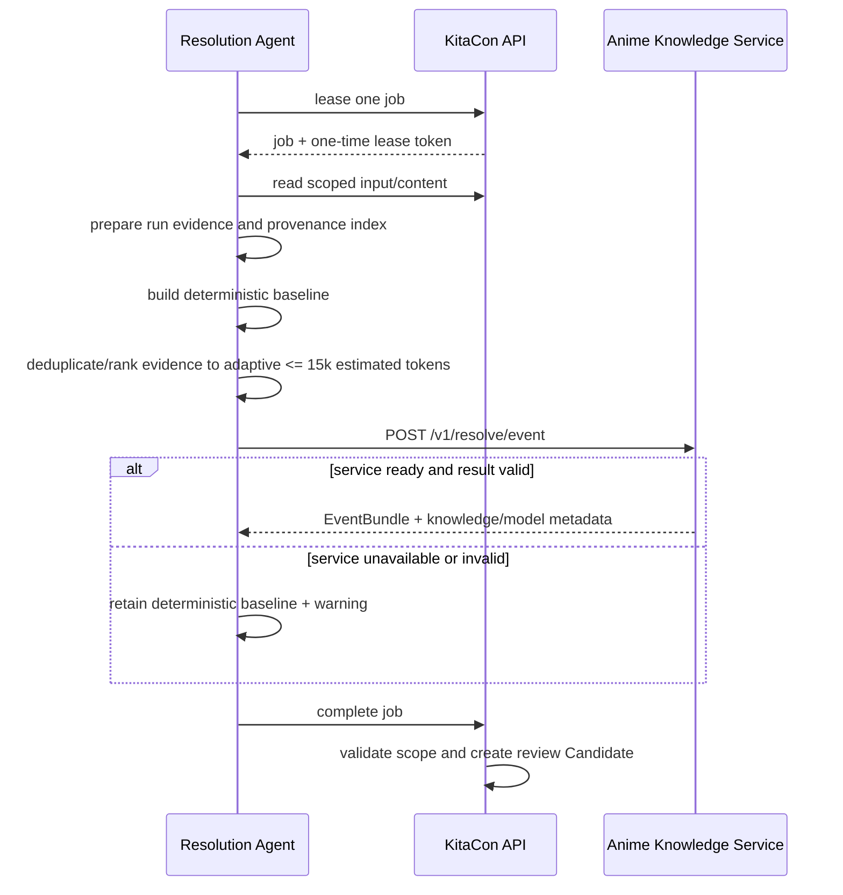

# Architecture

## System context

## Responsibilities

| Component | Owns |
| --- | --- |
| KitaCon | sources, crawler runs, jobs, evidence authorization, database, Candidates, review, publication |
| Evidence Pipeline | lossless run-level grouping, collection merge, conflicts, provenance and Bundle v2 indexes |
| Resolution Agent | lease lifecycle, prepared-input consumption, artifact hydration, deterministic baseline, token ranking/budget, submission/failure |
| Anime Knowledge Service | Bangumi imports/indexes, retrieval, prompts, Ollama, identity validation, semantic resolution |
| Ollama | GGUF loading, Metal inference, model memory lifecycle |

## Event sequence

## Trust model

The Agent never gives Anime Knowledge Service a lease token, database credential, object key, or arbitrary fetch capability. It sends already-authorized, bounded evidence. KitaCon validates evidence IDs again when the completed EventBundle is submitted.

## Evidence preparation and compaction

`@kita/evidence-pipeline` runs first. It groups equivalent documents, assertions, chunks and media, merges structured collection records, retains all supporting document IDs, and reports conflicts. This is the `Evidence prepared` state shown in the Candidate workflow and the same code used by the manual Bundle v2 export.

`src/pipelines/evidence-compactor.ts` is the policy boundary for data leaving the Agent:

1. Assertions are keyed by normalized `fieldPath + value`; the highest-confidence/page-priority copy wins. Different values for the same field remain so conflicts are visible.
2. Chunks are whitespace/Unicode normalized and globally deduplicated, then ranked by page type and event/entity signals.
3. Media URLs are canonicalized, tracking/resize variants collapse to the best crawler-scored/largest candidate, and icon/navigation assets are discarded.
4. Raw page text is admitted only for documents without assertions and chunks.
5. Ranked items are added until the conservative token estimator reaches `AGENT_EVIDENCE_TOKEN_BUDGET`.

The compactor never invents content, summarizes with an LLM, or changes document IDs. Its structured log records source, unique, selected, and dropped counts plus the estimated token total.
